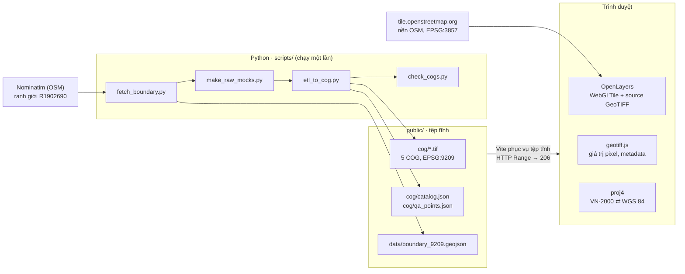
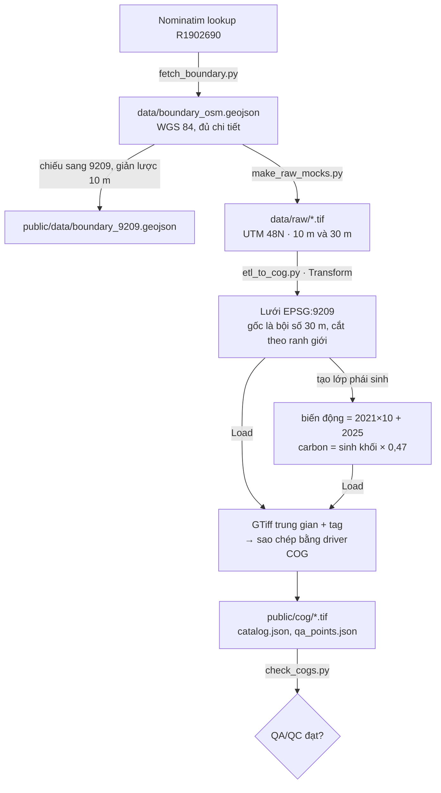
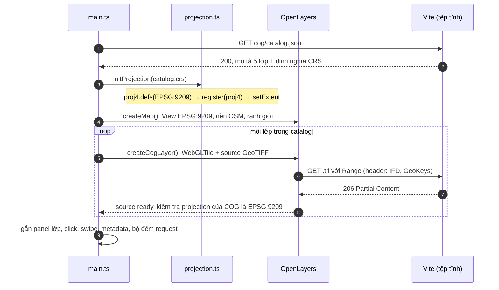
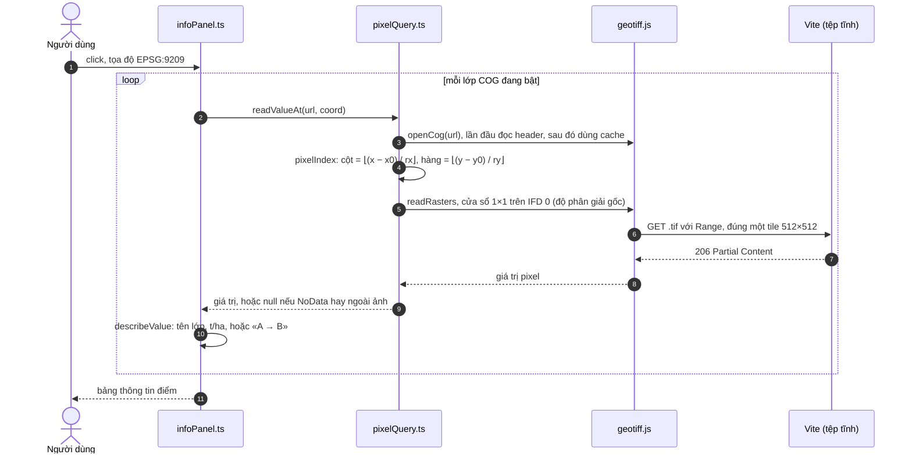

# Tech stack và luồng hoạt động

Tài liệu này mô tả các công nghệ PoC sử dụng và cách dữ liệu đi từ bước sinh dữ liệu giả lập tới khi hiển thị trên bản đồ. Cách chạy và các ghi chú kỹ thuật ngắn có trong [README](../README.md).

**Tóm tắt:** PoC gồm hai phần tách biệt.
- **Python** sinh dữ liệu giả lập và chạy ETL ra các tệp COG ở hệ VN-2000 (EPSG:9209). Phần này chạy một lần.
- **Trình duyệt** dùng **OpenLayers** để đọc trực tiếp các tệp đó qua HTTP Range và hiển thị. Không có backend hay máy chủ bản đồ ở giữa.

---

## 1. Kiến trúc tổng quan

| Khối | Làm gì | Khi nào chạy |
|---|---|---|
| `scripts/` (Python) | Tải ranh giới tỉnh, sinh raster thô, chạy ETL ra COG, kiểm tra QA/QC | Một lần, hoặc khi muốn sinh lại dữ liệu |
| `public/` | Chứa COG, mô tả lớp (`catalog.json`), điểm kiểm tra và ranh giới | Được phục vụ như tệp tĩnh |
| `src/` (TypeScript) | Bản đồ và giao diện, đọc COG trực tiếp trên trình duyệt | Mỗi lần mở trang |

---

## 2. Tech stack

### 2.1. Bản đồ (trình duyệt)

| Thư viện | Phiên bản | Vai trò |
|---|---|---|
| **OpenLayers** (`ol`) | 10.11.0 | Lõi bản đồ: view, pan/zoom, các lớp, thước tỷ lệ, ô tọa độ, nút về toàn tỉnh |
| ↳ `ol/source/GeoTIFF` + `ol/layer/WebGLTile` | | Đọc COG và vẽ bằng **WebGL**: GPU tô màu theo biểu thức style |
| ↳ `ol/source/OSM` + `ol/layer/Tile` | | Nền OpenStreetMap, được OpenLayers chiếu lại sang VN-2000 ngay trên trình duyệt |
| ↳ `ol/layer/Vector` + `ol/format/GeoJSON` | | Đường ranh giới tỉnh |
| **proj4** | 2.23.0 | Định nghĩa VN-2000 / TM-3 105°30′ (EPSG:9209) kèm 7 tham số `towgs84` |
| **geotiff.js** | 3.1.0-beta.0 (ghim cố định) | Đọc giá trị pixel ở độ phân giải gốc khi click; đọc metadata từ header COG. Trùng phiên bản OpenLayers dùng, nên chỉ có một bản trong `node_modules` |

### 2.2. Khung ứng dụng

| Thành phần | Lựa chọn | Ghi chú |
|---|---|---|
| Ngôn ngữ | TypeScript 6.0.3 | `strict`, `verbatimModuleSyntax`, `erasableSyntaxOnly` |
| Build và dev server | Vite 8.3 | `appType: 'mpa'`, để tệp thiếu trả 404 thay vì `index.html` |
| Giao diện | TypeScript thuần, thao tác DOM trực tiếp; CSS tự viết | Không dùng framework. Lõi `src/map/` tách riêng nên chép được sang một ứng dụng React |
| Runtime | Node 24 (chỉ để build và chạy dev server) | Bản build là tệp tĩnh, đặt trên web server nào cũng được miễn có hỗ trợ HTTP Range |

### 2.3. Pipeline dữ liệu (Python 3.13)

| Thư viện | Phiên bản | Vai trò |
|---|---|---|
| **rasterio** (kèm **GDAL** 3.12.2) | 1.5.2 | Chiếu lại raster, cắt theo ranh giới, tính overview, ghi COG bằng driver `COG` của GDAL |
| **numpy** | 2.5.4 | Sinh dữ liệu giả lập: nhiễu fractal, phân lớp, sinh khối |
| **pyproj** (PROJ 9.8.1) | 3.8.0 | Chuyển hệ tọa độ; đối chiếu phép chiếu của PROJ với chuỗi proj4 dùng ở trình duyệt |
| **shapely** | 2.2.0 | Hình học ranh giới: chiếu, giản lược, tính diện tích |

### 2.4. Định dạng dữ liệu

| Dữ liệu | Định dạng | Chi tiết |
|---|---|---|
| Raster | **COG** (Cloud Optimized GeoTIFF) | EPSG:9209 · tile 512×512 · DEFLATE (predictor 2 cho số nguyên, 3 cho số thực) · overview MODE (lớp phân loại) hoặc AVERAGE (lớp liên tục) · tag metadata của GDAL |
| Ranh giới | GeoJSON | Đã ở EPSG:9209, giản lược 10 m |
| Mô tả lớp | `catalog.json` | URL, kiểu lớp, bảng lớp và màu, thang màu, diện tích, ma trận chuyển đổi, sha256 |
| Điểm kiểm tra | `qa_points.json` | Giá trị Python đọc từ chính các tệp COG, dùng cho self-test |

---

## 3. Luồng dữ liệu: ETL giả lập (Python)

| Bước | Script | Đầu vào → đầu ra | Điểm chính |
|---|---|---|---|
| Ranh giới | `fetch_boundary.py` | Nominatim → GeoJSON | Tra theo **ID** R1902690 (Bắc Ninh sau sáp nhập). Kiểm tra khung bao và diện tích (khoảng 4 712 km²) |
| Extract (giả lập) | `make_raw_mocks.py` | → `data/raw/*.tif` (UTM 48N) | Nhiễu fractal có seed cố định; xu hướng Đông Bắc nhiều rừng, Tây Nam đồng bằng; có sông và hồ; năm 2025 lấy từ 2021 rồi thêm các mảng biến động |
| Transform | `etl_to_cog.py` | → mảng trên lưới EPSG:9209 | Lớp phân loại lấy mẫu nearest, sinh khối lấy mẫu bilinear. Gốc lưới là bội số 30 m, nên mỗi pixel 30 m trùng khít 3×3 pixel 10 m. Cắt theo ranh giới |
| Phái sinh | `etl_to_cog.py` | → biến động, carbon | Biến động tính theo từng pixel trên cùng một lưới |
| Load | `etl_to_cog.py` | → `public/cog/*.tif` | Ghi tag vào GTiff trung gian, rồi sao chép sang COG. Sửa trực tiếp tệp COG sẽ làm hỏng bố cục COG |
| QA/QC | `check_cogs.py` | Đọc lại các COG cuối | Kiểm tra CRS, `LAYOUT=COG`, kiểu nén, predictor, tile, số overview, NoData, giá trị nằm trong bảng lớp (cả ở overview), quan hệ giữa các lớp, sha256 |

---

## 4. Luồng chạy trên trình duyệt

### 4.1. Khởi tạo trang

Thứ tự **bắt buộc**: phải `initProjection()` trước khi tạo View hoặc bất kỳ source nào.
- `ol/source/GeoTIFF` đọc mã `ProjectedCSTypeGeoKey = 9209` trong tệp rồi tra `EPSG:9209` trong bộ nhớ của OpenLayers.
- Nếu mã đó chưa được đăng ký, OpenLayers tự tạo một projection rỗng mà **không báo lỗi**. Khi đó lớp COG sẽ lệch khỏi bản đồ nền.
- `cogLayer.ts` vì vậy kiểm tra lại projection mỗi khi một source sẵn sàng.

### 4.2. Vẽ lớp COG khi pan/zoom

1. OpenLayers dựng **lưới tile** từ các IFD của COG: ảnh gốc và các overview, mỗi mức tương ứng một độ phân giải.
2. Ở mỗi mức zoom, OpenLayers chọn mức ảnh gần nhất, rồi chỉ yêu cầu **khoảng byte** của các tile 512×512 nằm trong khung nhìn. Khi zoom ra xa, nó dùng overview nên chỉ tải vài tile nhỏ cho toàn tỉnh.
3. geotiff.js giải nén DEFLATE và áp predictor.
4. Giá trị thô được đưa lên GPU dưới dạng texture (`normalize: false`), kèm một band alpha tạo từ tag `GDAL_NODATA`.
5. Shader áp biểu thức style:
   - Lớp phân loại: `['palette', ['band', 1], [...]]`, tức tra màu theo mã lớp.
   - Lớp liên tục: `['interpolate', ['linear'], ['band', 1], 0, màu, …]`, tức nội suy theo thang màu.
   - Pixel NoData bị loại bỏ.
6. `interpolate: false`, tức lấy mẫu nearest: giữ nguyên mã lớp và không tạo viền ở mép NoData.

Kết quả: đổi màu hay thang màu chỉ là đổi style, không phải tải lại dữ liệu. Thanh trạng thái đếm số request `.tif` và số KB đã tải so với tổng dung lượng, nhờ Resource Timing API của trình duyệt.

### 4.3. Click xem giá trị pixel

PoC **không dùng** `layer.getData()` của OpenLayers. Hàm đó trả giá trị của tile đang hiển thị, tức là ở mức overview theo mức zoom. Overview AVERAGE của sinh khối khác giá trị gốc, nên không đáp ứng yêu cầu "giá trị điểm khớp raster nguồn" (KB04). Đọc ở IFD 0 bảo đảm giá trị khớp tuyệt đối.

### 4.4. Panel metadata

`cogMetadata.ts` mở cùng tệp COG bằng geotiff.js và chỉ đọc header:
- kích thước, độ phân giải, gốc, khung bao;
- mã EPSG từ GeoKeys;
- tile, kiểu dữ liệu, NoData;
- kiểu nén và predictor (`fileDirectory.loadValue`);
- danh sách overview;
- ghost header của GDAL (`LAYOUT=IFDS_BEFORE_DATA`), dấu hiệu tệp là COG thật;
- tag metadata của lớp và của band (`getGDALMetadata`).

Các lệnh đọc chạy **tuần tự**, vì geotiff 3.1.0-beta.0 trả `null` khi hai lệnh đọc song song cùng một tag.

### 4.5. So sánh 2021 / 2025 (swipe)

Lớp 2025 nằm trên lớp 2021. Khi bật swipe, `swipe.ts` gắn hai sự kiện vào lớp 2025:
- `prerender`: bật **WebGL scissor**, chỉ cho vẽ phần bên phải thanh trượt. `getRenderPixel` quy đổi pixel CSS sang pixel canvas, có tính `devicePixelRatio`.
- `postrender`: tắt scissor.

Mỗi lần kéo thanh trượt chỉ gọi `map.render()`, không tải lại dữ liệu. Đây là **tính năng thêm của PoC**: "side-by-side / swipe comparison" nằm ngoài phạm vi UC09.

### 4.6. Self-test

Nút "Chạy self-test", hoặc thêm `?selftest` vào URL, chạy `selfTest.ts`:
1. **Phép chiếu:** `transform()` của OpenLayers/proj4 tại 5 điểm phải lệch dưới 0,01 m so với giá trị PROJ ghi sẵn trong `qa_points.json`.
2. **Giá trị pixel:** 275 điểm (55 điểm cho mỗi lớp) phải khớp **tuyệt đối** với giá trị Python đọc từ chính các tệp COG đó. Các điểm gồm pixel ngẫu nhiên, pixel ở mép ranh giới, ở mép lớp và ngoài tỉnh.

---

## 5. Hệ tọa độ VN-2000

| Đối tượng | Hệ gốc | Chiếu lại ở đâu |
|---|---|---|
| Lớp COG | EPSG:9209 | **Không chiếu**: View dùng chính EPSG:9209, OpenLayers vẽ thẳng pixel |
| Ranh giới tỉnh | EPSG:9209 (đã chiếu bằng PROJ lúc ETL) | Không chiếu |
| Nền OSM | EPSG:3857 | OpenLayers chiếu lại từng tile sang VN-2000 trên trình duyệt, dùng proj4 |
| Kinh/vĩ độ trên ô tọa độ | EPSG:9209 → WGS 84 | proj4 (`toLonLat`) |

- Ô tọa độ theo quy ước Việt Nam: **X = Bắc (Northing), Y = Đông (Easting)**. Trục của EPSG:9209 là (Đông, Bắc), nên `X = coord[1]` và `Y = coord[0]`.
- **Chuỗi `+towgs84`:**
  - EPSG công bố 7 tham số VN-2000 theo quy ước *coordinate frame*, còn proj4 hiểu `+towgs84` theo quy ước *position vector*. Vì vậy 3 tham số xoay phải **đảo dấu**.
  - Chuỗi trong PoC khớp PROJ/GDAL tuyệt đối (kiểm bằng `scripts/check_proj.py` và self-test).
  - Nếu giữ nguyên dấu thì lệch khoảng 0,76 m; bỏ hẳn `towgs84` thì lệch khoảng 224 m.
- Chuỗi proj4 không viết cứng trong mã mà đọc từ `catalog.json` (`crs.proj4`). Đổi kinh tuyến trục chỉ cần sửa `scripts/config.py` rồi chạy lại ETL.

---

## 6. Cấu trúc mã

| Tệp | Trách nhiệm |
|---|---|
| `src/main.ts` | Ghép các phần: tải catalog → đăng ký projection → tạo bản đồ và lớp → gắn UI |
| `src/map/catalog.ts` | Kiểu dữ liệu và hàm tải `catalog.json`, `qa_points.json` |
| `src/map/projection.ts` | Đăng ký EPSG:9209 (proj4 + `register` + `setExtent`) |
| `src/map/createMap.ts` | View EPSG:9209, nền OSM, ranh giới, các control |
| `src/map/cogLayer.ts` | Lớp COG (WebGLTile + GeoTIFF) và kiểm tra projection |
| `src/map/styles.ts` | Biểu thức style WebGL (palette / interpolate) |
| `src/map/pixelQuery.ts` | Mở COG bằng geotiff.js (có cache), đọc pixel ở độ phân giải gốc |
| `src/map/cogMetadata.ts` | Đọc metadata từ header COG |
| `src/map/coordinates.ts` | Ô tọa độ VN-2000 / WGS 84, thước tỷ lệ |
| `src/map/swipe.ts` | So sánh bằng WebGL scissor |
| `src/map/selfTest.ts` | Kiểm tra phép chiếu và giá trị pixel |
| `src/ui/*` | Giao diện DOM thuần: panel lớp, thông tin điểm, metadata, swipe, self-test |
| `scripts/*` | Pipeline Python ở mục 3 |

**Ranh giới module:**
- `src/map/` không phụ thuộc framework và không import gì từ `src/ui/`.
- `src/ui/` chỉ dành cho PoC.

---

## 7. Đối chiếu với hệ thống thật

| Thành phần | PoC | Hệ thống CK-GIS (theo yêu cầu) |
|---|---|---|
| Lưu raster | Tệp COG trong `public/` | Kho tệp COG; cơ sở dữ liệu chỉ giữ metadata và tham chiếu |
| Phục vụ bản đồ | Tệp tĩnh + HTTP Range, trình duyệt tự đọc COG | GeoServer (WMS/WMTS/WFS) + GeoWebCache |
| Mô tả lớp | `catalog.json` | API REST của backend Python (OpenAPI) |
| CSDL không gian | Không có | PostgreSQL / PostGIS |
| ETL | Script Python giả lập | Chuỗi ETL thật (GDAL / rasterio), tác vụ nền Celery + Redis |
| Ranh giới, dữ liệu | OSM và dữ liệu giả lập | Dữ liệu được bàn giao (vector, raster 2021 / 2025, sinh khối / carbon) |
| Giao diện | TypeScript thuần | Ứng dụng React; lõi `src/map/` có thể chép sang |
| Xác thực, phân quyền | Không có | Đăng nhập, RBAC |

**Để chuyển lõi bản đồ sang ứng dụng thật:**
- Thay `loadCatalog()` bằng mô tả lớp lấy từ API.
- Lấy chuỗi proj4 từ cấu hình của ứng dụng.
- Khi unmount component: gọi `map.setTarget(undefined)` và `layer.dispose()`.
